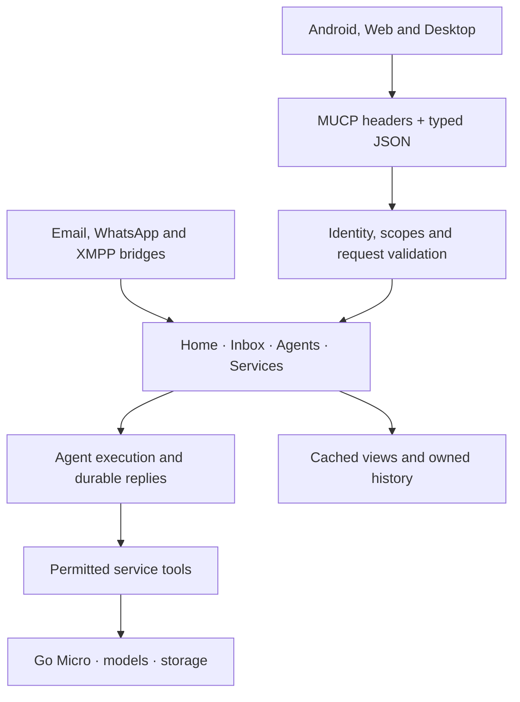

# Architecture and development

Mu is an open runtime for personal assistants. Micro is its general-purpose agent;
other agents can have different instructions and permitted tools. Go Micro is the
underlying framework. Mu combines agents, services, accounts and persistent history
into a running system that clients can use.

## Client, protocol and server



Android and the focused client in `client/web` use the MUCP HTTPS/JSON
binding for Home, Inbox, agents, service discovery and durable replies. The React/TypeScript web client runs independently and connects to a selected
runtime using OAuth/PKCE and explicit tokens. Mu also serves the build at `/app/`,
where it reuses same-origin session cookies with CSRF protection. Desktop installers
bundle the React app with Electron and use system-browser OAuth.
The PWA belongs to the full runtime web experience, not the standalone client.
The server uses go-micro with an in-memory transport internally.
The web console is server-rendered composition, not currently an independent MUCP
client. It remains useful for overview, administration and direct service use.

## Layers and ownership

| Layer / package | Responsibility |
| --- | --- |
| `client/` and standalone web client | Input, voice capture, playback and safe result rendering |
| `proto/` | Shared interface/type definitions; not runtime implementation |
| `internal/server` | Compose routes, authenticated protocol entry points and product pages |
| `agent/` | Assistant operations, agent selection and execution; uses permitted services |
| `service/` | Bottom-layer capabilities and their data; independently callable through authorised interfaces |
| `internal/` | Shared substrate including identity, threads, quota and storage |
| Home / Inbox / Agents / Services views | Web composition over those capabilities |

The assistant is the client-facing interface to agents, not an additional service
beneath them. There is no `service/assistant` wrapper calling upward into `agent/`.
A protobuf `service Assistant` is an RPC declaration, not a package-layer rule.
Services do not call each other or launch agent reasoning; they publish facts and
higher-level subscribers decide what work to run. Server composition may reach
both layers; that does not authorise upward dependencies from services.

`proto/assistant/v1` owns the composition contract. `proto/service/<name>/v1` owns the public service contracts. Contacts, Chat,
Groups and Notes have direct bindings through the existing gateway. Other
services migrate incrementally, with typed adapters and permission tests. The
existing Specs remain authoritative for current APIs and agent tools.

## One assistant interaction

```text
 Client                 Assistant / agent                  Services
   |                            |                              |
   | list agents, list threads  |                              |
   |--------------------------->|                              |
   | descriptors, thread IDs    |                              |
   |<---------------------------|                              |
   | ask(agent, thread, prompt) |                              |
   |--------------------------->| authenticate / check scope   |
   |                            | resolve agent + history      |
   |                            | reason / choose tools        |
   |                            | permitted capability call    |
   |                            |----------------------------->|
   |                            | tool result                  |
   |                            |<-----------------------------|
   |                            | finish answer, retain turn   |
   | text + content + thread    |                              |
   |<---------------------------|                              |
   | render / speak             |                              |
```

The `/` adapter implements the composition contracts, personal thread reads,
Ask, durable Submit and ReadOperation. Existing execution
already resolves agents, checks permissions, uses tools and retains personal
threads. `thread` is the existing identifier for what the UI calls a conversation;
there is no second conversation-ID namespace. A request ID identifies an exchange,
not the persistent thread. Listing and reading must project authorised personal
assistant threads, not dump mail, other users' records or internal execution logs.

Clients render typed content as data. A video reference is not proof of playback
and does not override provider restrictions. Stopping speech is local and immediate;
cancelling server work is separate, best effort and not yet defined in the draft.

## Cross-cutting guarantees

Authentication establishes account identity at the boundary; caller-supplied IDs
or metadata cannot establish it. Agent instructions and tool permissions are
resolved on the server. Quotas, billing and service authorisation remain enforced
when requests arrive through another client or encoding. Public-question mode is
explicitly restricted and must never silently become a personal request.

`internal/thread` stores conversation history. Inbox projects incoming messages
and notifications; it is not a second execution engine. `agent/exec` owns delegated
execution and `agent/work` its product view; `service/tasks` retains task records.
Transport retries do not imply idempotency, and a lost connection does not prove
that an action failed. Clients must not automatically repeat ambiguous mutations.

Self-hosting controls the runtime but does not make external model calls local.
Data boundaries must hold when tools access private sources and when information
is sent to configured model providers. MUCP does not itself promise federation,
end-to-end encryption, offline execution or portability of stored account data.

See [MUCP](MUCP.md) for the contract/transport distinction and implementation status.
Deployment belongs in [Hosting](HOSTING.md); settings in [Configuration](CONFIGURATION.md).

## Build from source

You need Git and Go 1.26 or later:

```sh
git clone https://github.com/micro/mu.git
cd mu
go build -o mu .
./mu --serve --address 127.0.0.1:8080
```

Open <http://localhost:8080> to complete setup.

## Extending a running instance

Mu uses go-micro to run its built-in services and agent loops. There are three
ways to build on an instance; they have different deployment requirements.

### Agents hosted by Mu

Open `/agents` while signed in and create an agent with a name, instructions,
and the services it may use. This is stored configuration: you do not fork,
recompile or restart Mu to create an agent. Mu runs its loop using the instance's
configured model providers. Talk to it from its agent page or use:

```sh
mu ask --agent research "Summarise the latest news"
```

The CLI must be logged into the intended instance. Creating an agent does not
install arbitrary executable code or start a separate operating-system process.

### Programs using Mu

Programs reach the assistant through the MUCP contracts at `/`, or use the
product JSON interfaces at `/agent`, `/inbox` and `/work` documented in
`/developers`. Agent owns execution; clients send prompts and recover responses.
Home and Inbox compose existing records. Chats, groups and contacts remain
services beneath that composition, with their own contracts and permissions.

Create a token at `/account/tokens`, or use OAuth with the scopes advertised by
`/.well-known/oauth-authorization-server`. Assistant capabilities apply across
the token owner's account; they do not isolate an application's conversations
or disable memory. Service scopes do not grant agent execution, and assistant
capabilities do not grant direct service calls.

The service interfaces at `/api/v1/<service>/<method>` and `/mcp` expose service
tools, not the assistant composition. Direct MUCP service bindings use the same
service permission boundary. A separately configured x402 host retains its
existing payment contract.

### Services running outside Mu

External mDNS discovery is disabled. Mu uses in-process service transport even
when `MU_REGISTRY=mdns` is set, and logs that the setting was refused. The old
network RPC mode accepted unauthenticated account metadata. External services
need authenticated, account-scoped transport before discovery can be restored.

## Contract ownership

`proto/assistant/v1` describes product composition; `proto/service/<name>/v1`
describes individual services. Contracts do not import runtime implementation.
The HTTPS binding (`internal/mucp`) imports no product packages. Explicit server
composition selects supported adapters, rather than exposing every internal RPC.
Contacts, Chat, Groups and Notes are independently callable typed services.
Public contracts are maintained in proto; Go handlers implement generated types.
Other services remain discoverable without claiming direct protocol support.

Durable submission reuses the agent reply queue and existing thread store. Home
and Inbox are projections; they never implement an agent loop. Account identity,
permissions, provider keys and spending policy remain runtime concerns. Clients
render typed results and recover operations; bridges translate their channels into
the same agent layer without making internal HTTP calls.
