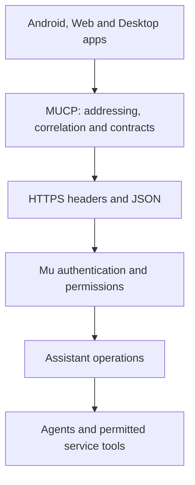

# Micro Communication Protocol (MUCP)

MUCP is Mu's public service-layer communication contract. Clients address an
operation with headers and send a typed body. The runtime owns execution,
identity, permissions, provider credentials, billing and persistent history.

**Implemented binding: `mucp/1`, JSON over HTTPS.** This document specifies that
binding. Streaming, cancellation, publish/subscribe and other transports are not
implemented. They must not be advertised or inferred from go-micro's internal
capabilities. MUST, MUST NOT and SHOULD express interoperability requirements.

## Layers



The contract lives in `proto/assistant/v1/assistant.proto`. Protobuf supplies
schemas and generated types, not mandatory binary RPC. Handwritten JSON clients
interoperate with generated Go and Java clients. Go Micro remains server-side
infrastructure; clients do not need its registry, transport or implementation.

Transport independence means preserving these semantics across bindings. It does
not replace TCP, UDP or QUIC. A future binding over NATS, RabbitMQ or another
carrier must specify addressing, authentication, framing, ordering, failures and
limits before it is supported. Broker delivery guarantees are not MUCP guarantees.

## Message model

An exchange has metadata and an encoded body. Required request metadata:

| Header | Meaning and permitted value |
| --- | --- |
| `Micro-Protocol` | Exact protocol identifier `mucp/1` |
| `Micro-Service` | Target contract; currently `assistant` |
| `Micro-Endpoint` | Exact, case-sensitive operation name |
| `Micro-Id` | Caller-generated correlation ID: 16–128 ASCII letters, digits, `_` or `-` |
| `Content-Type` | `application/json`; optional charset parameter is accepted |

Header names are case-insensitive in HTTP; values are case-sensitive. Required
headers MUST appear exactly once. Clients SHOULD generate a fresh UUID per new
exchange. An ID correlates a request and response; it is **not an idempotency key**.
Account IDs supplied in headers or bodies never confer identity or permissions.

Bodies use the standard protobuf JSON mapping: lowerCamelCase keys, enum names,
RFC3339 timestamps, base64 bytes and quoted 64-bit integers. A request MUST be one
JSON object, no more than 65,536 bytes. Unknown fields, duplicate fields and
unknown access modes are rejected. Clients MUST tolerate additive response
fields and render an unknown content block's `fallback` when available.

On transports without native headers, a future binding can carry metadata in an
envelope, for example `{"headers":{"micro-protocol":"mucp/1",...},"body":{...}}`.
Envelope metadata names would be canonical lowercase. This is an illustration,
not an additional accepted HTTP request format. Credentials belong to the
binding's authenticated channel and MUST NOT be forwarded into tool metadata.

## HTTPS binding

The base address is the runtime origin, for example `https://micro.mu`.

- `GET /` with `Micro-Protocol: mucp/1` returns public capabilities.
- `POST /` with the required metadata invokes an operation.
- Requests without the protocol header retain the normal website behaviour.
- `/mucp` remains the existing compatibility alias. New clients use `/`.
- HTTPS is required except for HTTP on a loopback address during local use.
- Clients MUST NOT follow redirects for authenticated protocol calls or silently
  fall back to another endpoint or version.

Discovery returns `protocol`, `service`, `contract`, `encoding`, `operations`,
`features` and `limits`. The current features are `threadRecovery: true`,
`streaming: false`, `cancellation: false`, `automaticRetry: false`. Limits include
`requestBytes: 65536`, `waitSeconds: 120` and `pageSize: 100`. Older servers may
omit features/limits; absence MUST NOT be interpreted as support. Discovery
contains no account data. A client may support `mucp/1` directly but MUST fail
clearly if the server returns an incompatible protocol.

Example request:

```http
POST / HTTP/1.1
Host: micro.mu
Micro-Protocol: mucp/1
Micro-Service: assistant
Micro-Endpoint: Assistant.Ask
Micro-Id: 1c0778d6-eebd-4b82-8aa8-327c72b32b79
Content-Type: application/json
Authorization: Bearer <scoped-token>

{"agentId":"micro","thread":"","prompt":"What is the weather?","mode":"ACCESS_MODE_PERSONAL","voice":false}
```

Successful responses are HTTP 200 protobuf JSON and echo `Micro-Protocol`,
`Micro-Service`, `Micro-Endpoint` and `Micro-Id`. Clients MUST verify at least
protocol and correlation before accepting a successful response. Response
headers are not duplicated in the JSON body. Errors before valid routing headers
are established may lack correlation; clients must still handle the HTTP failure.

## Accounts and sign-in

**Hosted web app:** when `/app/` and the selected runtime have the same origin,
the app uses the existing HttpOnly session cookie. `/session` checks sign-in and
refreshes the readable CSRF cookie. Every cookie-authenticated write MUST include
`X-CSRF-Token`; the runtime verifies it against the authenticated session. Logged-out
users go through the normal login/signup flow and return to `/app/`.

**Independent web, Android and desktop apps:** use browser OAuth authorization
code flow with S256 PKCE, state verification and `read write api:agent api:home api:inbox api:services` scopes.
Native apps use the system browser. The desktop callback uses a loopback listener,
a fresh state and a ten-minute validity window. Authorization codes are consumed
once; the PKCE verifier is not sent in the authorization URL. Client tokens MUST
only be sent to the selected runtime. Switching servers clears the app's session.

Native/programmatic calls send `Authorization: Bearer <token>`. Browser bearer
calls omit cookies. An explicit credential takes precedence over any cookie and
an invalid token MUST NOT fall back to cookie identity. Reads require read access;
Writes require write access. Product capabilities are explicit: `api:agent`
for Assistant operations, `api:home` for the composed Home overview (including its
recent inbox preview), `api:inbox` for Inbox, and `api:services` for catalogue
metadata. Existing tokens need renewed consent for newly requested capabilities.
Service-only tokens cannot invoke product operations; product-only tokens cannot
call raw services. Direct Contacts calls require `service:contacts` plus read/write
permissions as appropriate. Discovery never grants execution rights. All account, verification, quota and tool checks
remain enforced at the runtime boundary.

Cross-origin CORS is non-credentialed and limited to MUCP plus `/oauth/register`
and `/oauth/token`. It never grants account access or exposes dashboard pages.
Session cookies and CSRF tokens MUST NOT be sent to another origin. Models and
provider API keys remain on the runtime, never in clients.

## Assistant operations

| Endpoint | Request | Result |
| --- | --- | --- |
| `Assistant.ListAgents` | Empty object | Accessible agents and public descriptions; no private prompts |
| `Assistant.ListThreads` | Optional agent filter, page size and page token | Authorized personal assistant threads and next-page token |
| `Assistant.ReadThread` | Thread ID and optional pagination | Thread metadata, ordered messages, next-page token and `pending` |
| `Home.Overview` | Empty object | Accessible agents, recent inbox, pinned services, cached events and current public brief |
| `Inbox.List` | Pagination and unread filter | Owned inbox items across channels; held items excluded |
| `Inbox.Read` | Item ID and pagination | Safe messages without changing read state |
| `Inbox.MarkRead` | Item ID and unread boolean | Persisted read state |
| `Services.List` | Pagination | Service descriptions and supported direct contracts |
| `Services.Describe` | Service name | Description and implemented direct operations |
| `Assistant.Submit` | Stable message ID and PERSONAL Ask request | Durable operation receipt |
| `Assistant.ReadOperation` | Operation ID | Owned operation state and terminal result |
| `Assistant.Ask` | Agent ID, thread ID or empty string, prompt, access mode and voice preference | Thread ID, responding agent, Markdown text and typed content |

The protobuf schema defines all fields and enum values. Use `thread`, not a second
conversation identifier. The runtime derives ownership from credentials, checks
access on each call and excludes service-owned mail/chat records from assistant
thread history. Inaccessible and nonexistent threads both return 404.

`ACCESS_MODE_PERSONAL` creates or continues a durable personal assistant thread.
`ACCESS_MODE_PUBLIC` is still authenticated and metered, has restricted tools and
is stateless: it cannot continue a thread. Unspecified or unknown modes fail.
The `voice` field describes the interaction; it does not grant background listening
or require an audio transport. Clients own dictation and playback.


### Durable personal submission

`Assistant.Submit` returns an operation after the request and queue receipt have
been persisted. `messageId` is 16–120 ASCII alphanumeric, hyphen or underscore
characters, scoped to the caller. It is distinct from the exchange's `Micro-Id`.
Reusing it with the same request returns the same operation; changing the agent,
thread, prompt or voice preference returns a conflict. Leading/trailing prompt
whitespace is normalized. Omitted thread and the returned thread identify the same
submission. Completed receipts are retained for at least seven days from creation;
clients MUST NOT replay an ambiguous submission after that window. Account/thread
deletion or revoked agent access revokes recovery. This is deduplicated submission,
not a guarantee that an external tool produces its side effects exactly once.

ReadOperation returns queued, running, succeeded, failed or interrupted. A success
contains the same answer/content as Ask. Resume by operation ID; if the acceptance
response was lost, repeat Submit with the original message ID and unchanged body
within the retention window. Never generate a new message ID merely to retry.
A runtime restart preserves queued work and records interrupted in-flight work.
Operations are not universal approval or cancellation handles.

### Direct service contracts

`Micro-Service: contacts` uses `Contacts.List`, `Contacts.Find`, `Contacts.Add`
and `Contacts.Delete`, defined in `proto/service/contacts/v1`. These adapt the
existing service gateway and its account/metering checks. Delete is an explicit
write and remains unavailable as an autonomous destructive model tool. Other
services remain available to agents through their existing tools; their catalogue
entries have no direct MUCP contract until a tested adapter ships.

Home reads cached local projections only. It does not fetch remote calendars,
invoke a model, or spend credits to render an overview. `calendarPending` signals
stale/missing calendar cache. Inbox reads do not grant permission to execute agents
on mail/group contexts. Current Inbox message projection exposes text and role;
personal assistant threads additionally expose structured result blocks.

## Completion and recovery

PERSONAL Ask submits to the existing persistent reply queue and waits up to 120
seconds. HTTP 200 returns the completed answer. Once acceptance is known, the
runtime exposes the thread in `Micro-Thread`, including on pending failures.

A 504 with `Micro-Thread` means the HTTP wait ended without a verified completed
response. ReadThread can recover saved messages and reports whether work remains
pending. A disconnected client can resume with its known thread; if the thread ID
was not received, ListThreads lets the user find the new chat. Clients SHOULD use
bounded polling and stop polling when the view is left or the outcome is terminal.

A network failure or generic intermediary 504 does **not** prove acceptance or
rejection. Clients MUST NOT automatically resend Ask. The queue deduplicates some
retained personal submissions, but there is no general replay window or permanent
idempotency guarantee. Retries can repeat paid work and external side effects.

Closing a socket, changing agents, interrupting speech or stopping local playback
MUST NOT be described as cancelling server work. There is no cancel operation.
Restarted in-flight work records interruption instead of blindly replaying tools.
PUBLIC requests have no durable-thread recovery guarantee.

Pagination is live, not a snapshot. Tokens are signed and scoped to account,
operation and filter; they expire after fifteen minutes or a runtime restart.
Clients restart pagination after expiration and deduplicate by record ID.
ReadThread is oldest-first. Maximum page size is 100.

## Errors

Protocol failures return a non-2xx HTTP status, `Micro-Error` machine code and:

```json
{"error":{"code":"invalid_arguments","message":"Send one valid protobuf JSON object","status":400}}
```

Authentication/authorization gates retain their existing product error bodies;
clients MUST use HTTP status even when the JSON error is absent or a plain string.
`Micro-Error: authorization_failed` marks failures from that gate. Error text is
for display, not branching. Never render an error body as executable HTML.

| Status | Meaning / client behaviour |
| --- | --- |
| 400 | Invalid metadata, version or arguments; correct the request |
| 401 | Sign in again; do not retry an action automatically |
| 402 | Credit required; direct the user to account management |
| 403 | Permission, verification or CSRF failure; do not downgrade authentication |
| 404 | Unknown operation/service or inaccessible resource |
| 405 | Unsupported HTTP method |
| 409 | Acceptance conflict; inspect the thread before resubmitting |
| 413 / 415 | Body too large / unsupported encoding |
| 429 | Rate limited; do not replay mutations automatically |
| 5xx | Failure or uncertain outcome; recover through history when possible |

## Content and client safety

A reply has Markdown text and typed content blocks: sources, images, audio, video,
routes and resource references. Unknown fields are additive; unknown blocks use
fallback text. Clients MUST treat content as data, reject unsafe URL schemes and
avoid executing model-authored HTML, scripts or commands. Media references do not
promise background playback or override provider restrictions.

Rendered links are not tool permissions. Server-held confirmations and executable
actions require a future contract; clients MUST NOT invent them from model text.
Do not put prompts, credentials or private search text in URLs or access logs.
Opaque thread IDs may appear in navigation; protocol payloads carry them in bodies.

## Evolution and conformance

Additive response fields and content blocks are compatible. Removed protobuf field
numbers MUST be reserved and never reused. Changed field meanings, operation
semantics or required headers need a new protocol/contract version. Unsupported
features fail explicitly rather than masquerading as successful empty responses.

Shared examples in `proto/testdata` are consumed by Go, TypeScript and Java tests.
Server tests cover authentication, ownership, CSRF, parsing and recovery. Browser
and desktop tests exercise the actual client transports, sign-in and rendering.
A new client must pass these cases before claiming compatibility.

Before adding streaming or another binding, define event types and ordering,
terminal outcomes, cursor scope/retention, reconnect gaps, cancellation outcomes,
idempotency conflict handling and authentication revocation. None of these
semantics may be inferred from a TCP connection, an RPC stream or a broker queue.

See [Architecture](ARCHITECTURE.md), [contracts](https://github.com/micro/mu/tree/main/proto) and
[clients](https://github.com/micro/mu/tree/main/client). The historical MUCP RPC proposal and go-micro's
internal metadata are background; this implemented binding is the client contract.
